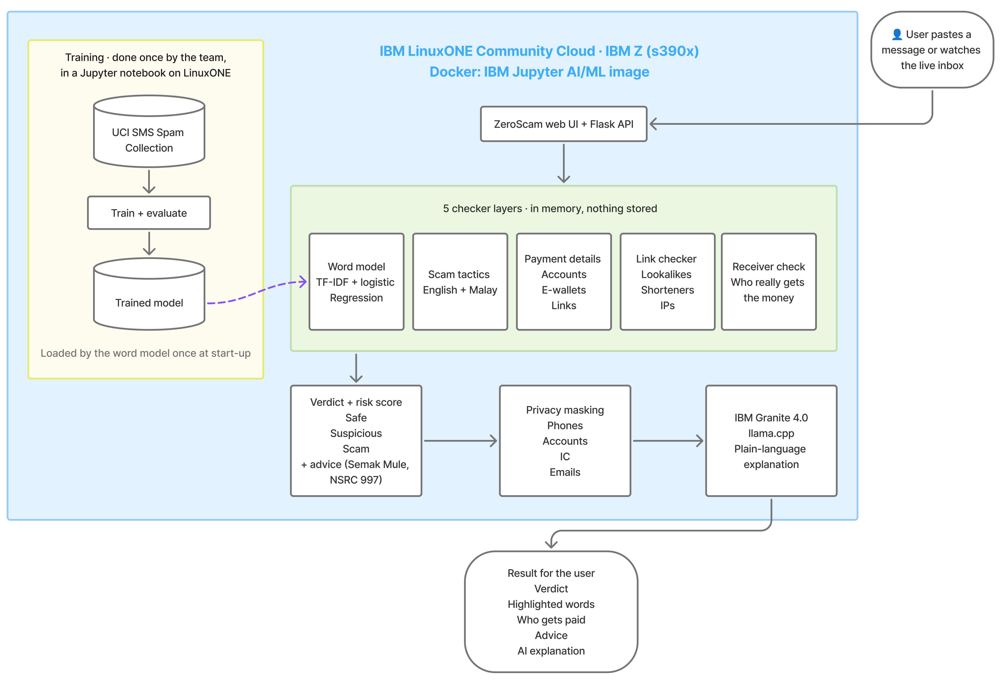

# ZeroScam — Team Zero, IBM Z Datathon 2026

ZeroScam is a real-time scam message checker. Paste an SMS or chat message, and ZeroScam, running on IBM
LinuxONE, tells you whether it is **Safe**, **Suspicious** or a **Scam**, shows which words gave it away, tells
you who a payment link really pays, and gives clear advice on what to do next. IBM Granite, running on the same
LinuxONE machine, explains the verdict in plain words. Messages are never stored.

Theme: **Real-Time AI for Critical Decisions**, with privacy by design.

## The problem

Scam messages trick people into paying fake fees, sending money to strangers or sharing bank details and
one-time passwords. Most victims cannot tell a scam from a genuine message until the money is gone. In 2024,
scams cost an estimated **3% of Malaysia's GDP**
([GASA, State of Scams in Malaysia 2024](https://gasa.org/knowledge-base/blog/where-did-the-billions-go-in-malaysia-thailand-taiwan))
and about **USD 1.03 trillion worldwide**
([GASA & Feedzai, Global State of Scams 2024](https://gasa.org/knowledge-base/blog/global-state-of-scams-report-2024-1-trillion-stolen-in-12-months-gasa-feedzai)).

ZeroScam is for everyday mobile users, especially elderly people and students, and for the banks, telcos and
awareness groups that protect them.

## What ZeroScam does

- **Verdict and risk score:** Safe / Suspicious / Scam with a risk score from 0 to 100.
- **Highlighted words:** the risky words and links are marked in the message, each with the reason.
- **Who gets the money:** for payment links, ZeroScam reads the receiver's name from the payment page and
  warns when it does not match the company the message claims to be from.
- **Advice:** what to do next, including checking an account at PDRM Semak Mule (semakmule.rmp.gov.my) and
  calling the National Scam Response Centre at 997.
- **AI explanation:** IBM Granite explains the verdict in one or two plain sentences.
- **Live inbox demo:** messages arrive on a phone screen one by one and are checked as they come in.
- **Dashboard:** our measured results, the model's top scam words, and scam losses around the world.

## Architecture



## How it works

Every message goes through 5 checker layers. Their findings are combined into one verdict and risk score.

1. **Word model** — TF-IDF + logistic regression, trained on IBM LinuxONE. Scores how scam-like the wording is.
2. **Scam-tactic detector** — 8 tactics in English and Malay: urgency, impersonation, prizes, threats, asking
   for passwords or OTPs, payment requests, easy money and pushing you to another chat.
3. **Payment-details warning** — spots payment links, bank account numbers and e-wallet phone numbers.
4. **Link checker** — flags lookalike domains, link shorteners, raw IP addresses and risky domain endings.
   51 official domains (Malaysian banks, e-wallets, government, couriers, utilities) are never flagged.
5. **Receiver check** — opens payment links safely (no scripts, 5-second limit, size limit, redirects checked,
   internal addresses refused) and reads who really receives the money.

After the verdict, ZeroScam builds the advice, masks personal details in the message (emails, IC numbers, long
account numbers), and sends the masked message, the verdict and the findings to **IBM Granite 4.0 (350M)**
through llama.cpp. Granite's answer goes through a quality check; if it is unclear, a short note is shown
instead and the checks above still apply.

## How it uses IBM LinuxONE

- Everything runs on an **IBM LinuxONE Community Cloud** virtual machine (s390x, Ubuntu 24.04), inside IBM's
  Jupyter Docker image for LinuxONE.
- The word model is **trained and evaluated on LinuxONE** in the Jupyter notebook `sms_spam.ipynb`.
- **IBM Granite runs on LinuxONE** through llama-cpp-python, using the model file supplied in IBM's image.
- The Flask API and the web page are served from the same LinuxONE machine. Messages are checked and explained
  there; they are never sent to an outside AI service.

## Results

Measured on the held-out test set of the SMS Spam Collection (1,035 messages: 904 genuine, 131 spam):

| | Logistic regression (chosen) | Naive Bayes |
|---|---|---|
| Accuracy | 0.976 | 0.953 |
| Spam precision | 0.896 | 1.000 |
| Spam recall | **0.916** | 0.626 |
| Spam F1 | **0.906** | 0.770 |

- **92% of scam messages caught** by the word model (recall 0.916).
- **93% of genuine messages passed as Safe** by the full checker (844 of 904); only 4 of 904 were called Scam.
- With all 5 layers, 124 of 131 spam messages were flagged as Suspicious or Scam.
- All 22 of the team's own test messages (English and Malay) get the expected verdict and findings.
- Granite answers in about 7 seconds on the VM.

## Screenshots

> 📸 **Screenshot placeholder:** checker page on the VM, Malay scam message → Scam, with highlighted words and the Granite explanation

> 📸 **Screenshot placeholder:** swapped-payee bill → Suspicious, "Payment goes to Ahmad Enterprise" while the message claims Syarikat Elektrik Contoh

> 📸 **Screenshot placeholder:** live inbox demo on the VM next to the Jupyter terminal showing each `POST /api/check`

> 📸 **Screenshot placeholder:** dashboard, "The scam landscape"

## How to run

On an IBM LinuxONE Community Cloud VM, set up Docker and IBM's Jupyter container as described in
[IBM's jupyter-lab-ml guide](https://github.com/linuxone-community-cloud/jupyter-lab-ml), with this repository
cloned into the `shared` folder. Then:

1. In Jupyter, open `sms_spam.ipynb` and run all cells. This trains the model and saves it to `models/`.
2. In a Jupyter terminal: `cd ~/shared && pip install flask`
3. Start the app: `python app.py` (it loads Granite first, then listens on port 38889).
4. Open the port on the VM firewall: `sudo iptables -I INPUT -p tcp --dport 38889 -j ACCEPT`
5. Open `http://<VM IP>:38889` for the checker and `http://<VM IP>:38889/inbox` for the inbox demo.

To run it on your own computer, install the libraries in `requirements.txt` and follow steps 1–3. Without the
Granite model file, everything works except the AI explanation, which shows a short note instead.

## Project structure

```
├── sms_spam.ipynb        training and evaluation (run on LinuxONE)
├── app.py                Flask: web page, /api/check, /api/explain, /api/stats, demo pages
├── checker/              the 5 layers, verdict, advice, privacy masking, Granite explanation
├── web/                  web UI source (React + Vite + Tailwind), built into static/app/
├── static/app/           built web UI
├── static/pay/           3 made-up payment pages for the receiver-check demo
├── docs/                 architecture diagram, open-source links
├── data/
│   ├── sms_spam_collection/   UCI SMS Spam Collection
│   ├── scam_tactics/          scam-tactic phrases, English + Malay
│   ├── link_check/            official domains, link shorteners, risky domain endings
│   └── test_messages/         22 made-up test messages with expected results
└── models/               trained model (created by the notebook, not committed)
```

## Data

- **[SMS Spam Collection](https://archive.ics.uci.edu/dataset/228/sms+spam+collection)** by Tiago A. Almeida
  and José María Gómez Hidalgo, UCI Machine Learning Repository, licensed under
  [CC BY 4.0](https://creativecommons.org/licenses/by/4.0/). 5,574 English SMS messages (87% genuine, 13% spam),
  included unchanged in `data/sms_spam_collection/`.
- The scam-tactic phrases, link lists and test messages were **created by the team with AI assistance** during
  the event. All names, companies and payment pages in the demo are made up.

## Privacy

- Messages are never stored or logged. The server log shows only the request line, not the message.
- Personal details are masked before the message reaches Granite.
- Granite runs on the same LinuxONE machine, so messages are not sent to any outside AI service.
- The only outgoing request is the receiver check opening a payment link found in the message, with strict
  safety limits.

## Limitations

- The word model is trained on English SMS only. There is no public Malay SMS scam dataset with a clear licence,
  so Malay is covered by the hand-made phrase lists.
- The phrase lists and link lists are hand-made starting points, not measured from real-world data.
- The dataset is from 2011; today's scams use different wording, apps and payment methods.
- Granite 4.0 350M is a small model; some answers fail the quality check and a short note is shown instead.
- The 22 test messages were written while the rules were built, so they show the rules work as designed, not
  how well they generalise.

## AI assistance

We used Claude Code (Anthropic) as a coding assistant during the event: for help writing and testing code,
drafting the scam-phrase lists, link lists and test messages, and writing documentation. The team designed
ZeroScam, decided every feature, reviewed every change, and ran and tested everything on IBM LinuxONE.

## Open-source credits

- [IBM LinuxONE Community Cloud](https://linuxone.cloud.marist.edu/) and IBM's
  [jupyter-lab-ml](https://github.com/linuxone-community-cloud/jupyter-lab-ml) image and labs
- [IBM Granite 4.0 H 350M](https://huggingface.co/ibm-granite/granite-4.0-h-350m-base)
- [llama-cpp-python](https://github.com/abetlen/llama-cpp-python) / [llama.cpp](https://github.com/ggml-org/llama.cpp)
- [scikit-learn](https://scikit-learn.org/)
- [Flask](https://flask.palletsprojects.com/)

**More:** the full list of libraries, design credits and data sources with links is in
[docs/open-source-links.md](docs/open-source-links.md).

## Team

Team Zero

| Name | University |
|---|---|
| Hossan Md Jamshed | University of Cyberjaya, Malaysia |
| MD Afrinoor Islam Noor | University of Cyberjaya, Malaysia |
| Hossain Turjo | University of Cyberjaya, Malaysia |
| MD Nasir Uddin | University of Cyberjaya, Malaysia |

## Licence

The code in this repository is under the MIT License (see `LICENSE`). The dataset in `data/sms_spam_collection/`
keeps its own CC BY 4.0 licence.
